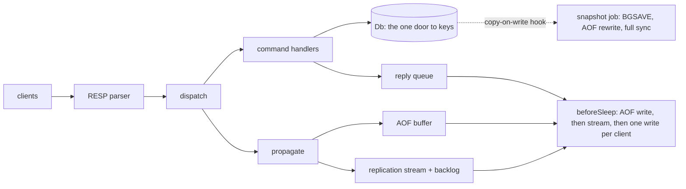
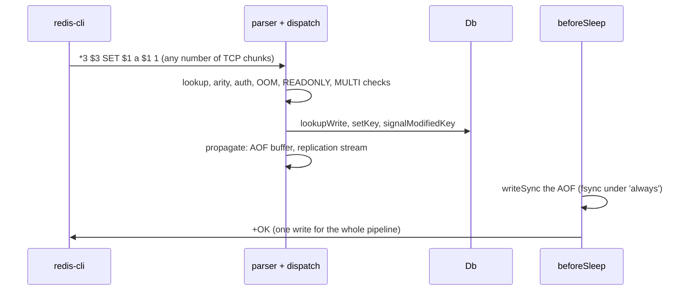
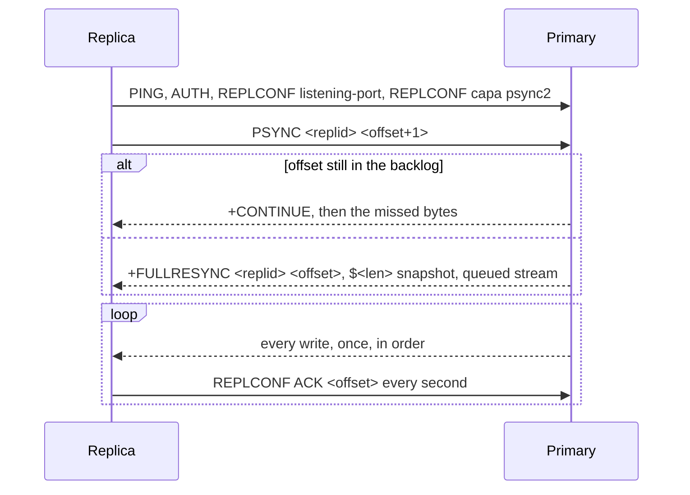

# MiniRedis

**A Redis-compatible in-memory database server, written from scratch in TypeScript with zero
runtime dependencies.** The real `redis-cli`, `redis-benchmark` and ioredis work against it
unchanged.

[](https://github.com/BUBAAcodes/mini-redis/actions/workflows/ci.yml)


<!-- GIF: redis-cli and redis-benchmark against MiniRedis, then kill -9 and the data coming
back. Record it with the script in "Recording the demo" below and save it as docs/demo.gif. -->

It has 16 databases, strings, lists, hashes, sets and sorted sets, TTLs with lazy and active
expiry, `maxmemory` with 8 eviction policies, an append-only file with three fsync modes and
background rewrite, point-in-time snapshots **without `fork()`**, crash recovery,
primary–replica replication with partial resync and WAIT, blocking pops, pub/sub, MULTI/EXEC
with WATCH, RESP2 and RESP3, password auth, client limits, INFO, SLOWLOG, MONITOR and a
Prometheus endpoint: 133 commands in all.

## Quick start

With Docker:

```bash
docker compose up -d miniredis      # build and start MiniRedis on port 6380
redis-cli -p 6380                   # any Redis client works
```

Or the published image:

```bash
docker run -p 6380:6380 ghcr.io/bubaacodes/mini-redis
```

Or from source, with Node 24 or later:

```bash
npm ci
npm run build
node dist/index.js miniredis.conf   # or: npm run dev
redis-cli -p 6380 set greeting hello
redis-cli -p 6380 get greeting
```

The port is 6380, so it never clashes with a real Redis on 6379. Every directive in
[miniredis.conf](miniredis.conf) can also be passed as a flag (`--appendonly yes`), and the
mutable ones changed at runtime with `CONFIG SET`.

A primary with two replicas:

```bash
docker compose --profile replication up -d --build
redis-cli -p 6380 set k v           # the primary
redis-cli -p 6381 get k             # replica 1: "v"
redis-cli -p 6381 info replication  # master_link_status:up
```

## How it compares with Redis

Same machine, both servers in Compose with the same persistence settings (AOF `everysec`, no
save points), and `redis-benchmark` run from inside the Redis container, so neither side gets
a networking advantage. 50 clients, 200,000 requests per test.

| Test           |  Redis | MiniRedis | MiniRedis / Redis | Redis, `-P 16` | MiniRedis, `-P 16` | MiniRedis / Redis |
| -------------- | -----: | --------: | ----------------: | -------------: | -----------------: | ----------------: |
| PING_MBULK     | 54,660 |    31,075 |               57% |        530,504 |            215,517 |               41% |
| SET            | 57,078 |    24,134 |               42% |        352,734 |            132,275 |               37% |
| GET            | 55,096 |    27,465 |               50% |        619,195 |            217,865 |               35% |
| INCR           | 52,645 |    25,961 |               49% |        312,989 |            142,552 |               46% |
| LPUSH          | 61,331 |    26,226 |               43% |        378,072 |            128,617 |               34% |
| HSET           | 54,825 |    33,162 |               60% |        383,877 |            106,895 |               28% |
| ZADD           | 42,726 |    28,914 |               68% |        483,092 |            165,017 |               34% |
| MSET (10 keys) | 40,667 |    15,728 |               39% |        119,689 |             33,630 |               28% |

Requests per second on an Intel i5-1145G7 laptop under WSL2 (Docker 29.8, Node 26.13, Redis
7.4.12). Memory for 1M keys with 100-byte values: 182 MB RSS for Redis, 770 MB for MiniRedis.
One profiled optimisation (in-place request parsing) made the parser 40–61% faster.

Full tables with p50 and p99 latencies, memory per key, restart times, replica lag, the machine
and the exact commands are in [bench/RESULTS.md](bench/RESULTS.md). Redis wins, as expected; the
interesting part is where and why, which that file explains.

## Architecture



One thread runs every command. Handlers only touch keys through `Db`, so expiry, WATCH,
memory accounting and snapshots see every change. Every write leaves through one
`propagate()` path, already rewritten into an exact form (`EXPIRE` → `PEXPIREAT`). Replies
only leave after the AOF bytes reached the OS. More, with the module map, in
[docs/ARCHITECTURE.md](docs/ARCHITECTURE.md).

### The life of one command



### The replication handshake



## Commands

| Group        | Commands                                                                                                                                                                                        |
| ------------ | ----------------------------------------------------------------------------------------------------------------------------------------------------------------------------------------------- |
| Strings      | GET SET GETEX GETDEL MGET MSET APPEND STRLEN INCR DECR INCRBY DECRBY INCRBYFLOAT GETRANGE SETRANGE                                                                                              |
| Keys         | DEL UNLINK EXISTS TYPE KEYS SCAN RENAME RANDOMKEY DBSIZE FLUSHDB FLUSHALL EXPIRE PEXPIRE EXPIREAT PEXPIREAT TTL PTTL PERSIST                                                                    |
| Lists        | LPUSH RPUSH LPOP RPOP LLEN LRANGE LINDEX LSET LINSERT LREM LTRIM LMOVE BLPOP BRPOP BLMOVE                                                                                                       |
| Hashes       | HSET HGET HMGET HDEL HEXISTS HLEN HKEYS HVALS HGETALL HINCRBY HINCRBYFLOAT HSCAN                                                                                                                |
| Sets         | SADD SREM SISMEMBER SMEMBERS SCARD SPOP SRANDMEMBER SINTER SUNION SDIFF SINTERSTORE SUNIONSTORE SDIFFSTORE SSCAN                                                                                |
| Sorted sets  | ZADD ZINCRBY ZSCORE ZCARD ZCOUNT ZRANGE ZRANGEBYSCORE ZREVRANGEBYSCORE ZRANGEBYLEX ZREVRANGE ZRANK ZREVRANK ZREM ZREMRANGEBYRANK ZREMRANGEBYSCORE ZPOPMIN ZPOPMAX ZSCAN ZUNIONSTORE ZINTERSTORE |
| Transactions | MULTI EXEC DISCARD WATCH UNWATCH                                                                                                                                                                |
| Pub/sub      | SUBSCRIBE PSUBSCRIBE UNSUBSCRIBE PUNSUBSCRIBE PUBLISH PUBSUB (CHANNELS, NUMSUB, NUMPAT)                                                                                                         |
| Connection   | PING ECHO QUIT SELECT AUTH HELLO RESET MONITOR CLIENT (ID, SETNAME, GETNAME, SETINFO, KILL, LIST, INFO)                                                                                         |
| Server       | COMMAND CONFIG TIME INFO SLOWLOG SHUTDOWN SAVE BGSAVE BGREWRITEAOF LASTSAVE OBJECT MEMORY DEBUG                                                                                                 |
| Replication  | REPLICAOF SLAVEOF PSYNC REPLCONF WAIT ROLE                                                                                                                                                      |

Behaviour, reply types and error strings match Redis 7.4. The intentional differences, each
with its reason, are in [docs/DIFFERENCES.md](docs/DIFFERENCES.md). Twenty-five more commands
(SETEX, SMOVE, LPOS, ZRANDMEMBER…) are left out on purpose, as exercises in
[docs/EXERCISES.md](docs/EXERCISES.md).

## How it's tested

| Suite                 | What it proves                                                                                                                                            | Run it                                            |
| --------------------- | --------------------------------------------------------------------------------------------------------------------------------------------------------- | ------------------------------------------------- |
| Unit                  | Parser, encoder, numbers, glob, dict, skip list, quicklist, CRC-64, snapshot format, LFU math                                                             | `npm test`                                        |
| Property (fast-check) | Dict, skip list and quicklist match plain models under random operations; SCAN never misses a key across resizes                                          | `npm test`                                        |
| Integration           | Every command group's happy paths and errors, pipelining, transactions, pub/sub, blocking, RESP3, auth and limits, against a real server on a random port | `npm test`                                        |
| Differential          | The same random commands sent to Redis 7.4 and to MiniRedis, every reply compared byte for byte                                                           | `docker compose up -d redis && npm run test:diff` |
| Crash                 | Writers, `kill -9` at random moments, restart: every acknowledged write is there, in all three fsync modes, for snapshots, and mid-BGSAVE or mid-rewrite  | `npm run test:crash`                              |
| Fuzz                  | Random and mutated input never crashes, hangs or bloats the server                                                                                        | `npm run test:fuzz`                               |
| Replication           | A primary and two replicas: equal digests after WAIT, partial resync after a kill, promotion with `+CONTINUE`                                             | `npm run test:repl`                               |
| Docs                  | Every `file:line` link in these docs points at the code it names                                                                                          | `npm test`                                        |

Knobs: `SEED` and `OPS` (differential; every run prints its seed, so `SEED=81723 OPS=20000
npm run test:diff` replays a failure exactly), `KILLS` (crash), `CASES` (fuzz).
`npm run test:all` runs everything. CI runs all of it on every push and publishes the image to
GHCR from `main`.

Benchmarks: `bash bench/run.sh` (Docker, both servers) and `bash bench/profile.sh` (profile
the built server under load). See [bench/RESULTS.md](bench/RESULTS.md).

## Design decisions

Each non-obvious choice has a short ADR in [docs/adr](docs/adr):

- **[Point-in-time snapshots without `fork()`](docs/adr/0010-copy-on-write-snapshots.md).** Node
  can't fork, so BGSAVE walks the keyspace in 2 ms slices and a hook saves a key's old value
  just before anything changes it. The same engine serves BGSAVE, AOF rewrite and replica full
  syncs.
- [Keys are latin1 byte strings](docs/adr/0001-byte-strings-latin1.md), never decoded as UTF-8.
- [MurmurHash3 with a random seed](docs/adr/0002-murmurhash3-random-seed.md), so nobody can craft colliding keys.
- [One `beforeSleep` per loop turn through `setImmediate`](docs/adr/0003-before-sleep-set-immediate.md): AOF first, then replies.
- [INCR in BigInt](docs/adr/0004-incr-bigint.md) and [INCRBYFLOAT in doubles](docs/adr/0005-incrbyfloat-doubles.md).
- [Expiry outside the dirty counter](docs/adr/0006-expiry-outside-dirty.md), [128 items per quicklist node](docs/adr/0007-quicklist-node-size.md), [one timer per blocked client](docs/adr/0008-one-timer-per-blocked-client.md).
- [One AOF file](docs/adr/0009-single-file-aof.md), [our own snapshot format](docs/adr/0011-snapshot-file-format.md), [the rewrite buffer](docs/adr/0012-aof-rewrite-buffer-and-wait-rewrite.md).
- [Memory estimates instead of an allocator](docs/adr/0013-memory-estimates.md).
- [The backlog, created once and never freed](docs/adr/0014-replication-backlog.md), and [replica offsets that count applied bytes](docs/adr/0015-replica-offset-counts-applied-bytes.md).
- [Output limits checked after the write](docs/adr/0016-output-limits-after-write.md), [HELLO's AUTH order](docs/adr/0017-hello-auth-order.md), [SHUTDOWN saves before closing](docs/adr/0018-shutdown-saves-before-closing.md).

## Limitations

In plain words (the full list is in [docs/DIFFERENCES.md](docs/DIFFERENCES.md)):

- **Slower than Redis**, several times so with pipelining: one V8 thread with a garbage
  collector against hand-tuned C (see [bench/RESULTS.md](bench/RESULTS.md)).
- **More memory per key**: no compact encodings (listpack, intset), and V8 objects are bigger
  than Redis's structs. Memory numbers are estimates, not allocator counts.
- **BGSAVE shares the one thread** with clients, in 2 ms slices. Redis's forked child runs on
  another core.
- **Not file-compatible**: its own snapshot format and a single-file AOF, so no RDB files in or
  out. Replication only works between MiniRedis servers, without chained replicas.
- **No** Lua, modules, Streams, HyperLogLog, geo, bitmaps, Cluster, Sentinel, ACL users
  beyond one password, TLS, or keyspace notifications.
- Bulk strings are capped at 64 MB (V8's string limit), not 512 MB.

## Recording the demo

The GIF above is recorded by hand: start `docker compose up -d --build miniredis`, then in one
terminal run `redis-cli -p 6380`, `SET user:1 alice`, `RPUSH q a b c`, and
`docker compose exec redis redis-benchmark -h miniredis -p 6380 -q -n 100000 -t set,get`;
then `docker compose kill -s SIGKILL miniredis`, `docker compose up -d miniredis`, and
`redis-cli -p 6380 GET user:1` shows `"alice"` again. A tool such as
[asciinema](https://asciinema.org) plus `agg` turns it into `docs/demo.gif`.

## How it was built

Designed by me: the spec ([docs/SPEC.md](docs/SPEC.md)), the build order, the test strategy and
every design decision. Built step by step with [Claude Code](https://claude.com/claude-code),
one reviewed step per commit, each with a walkthrough in [docs/walkthroughs](docs/walkthroughs).
Reviewed, tested and studied by me: [docs/INTERVIEW.md](docs/INTERVIEW.md) answers the hard
questions with links into the code, and [docs/EXERCISES.md](docs/EXERCISES.md) breaks it on
purpose.

---

Redis is a trademark of Redis Ltd. MiniRedis is an independent learning project, not
affiliated with it.
