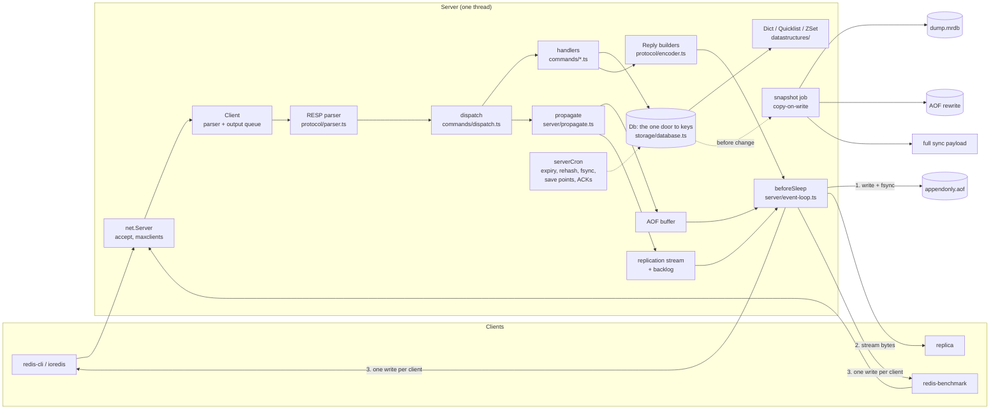
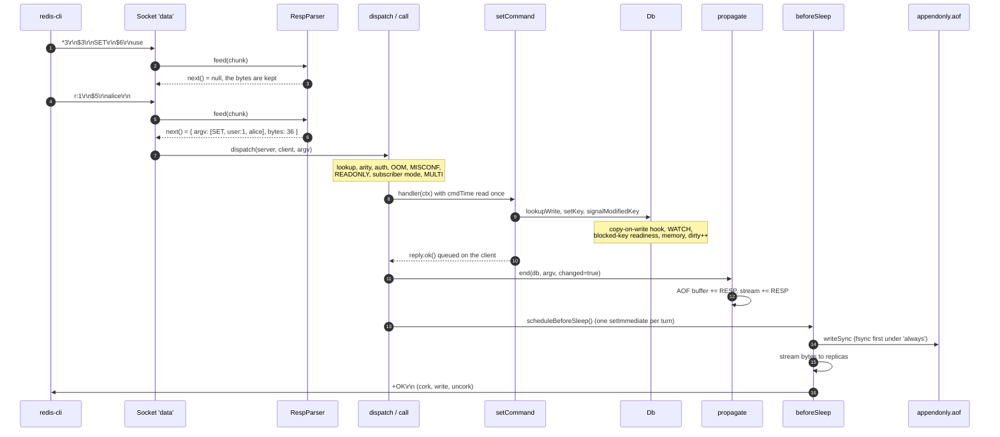
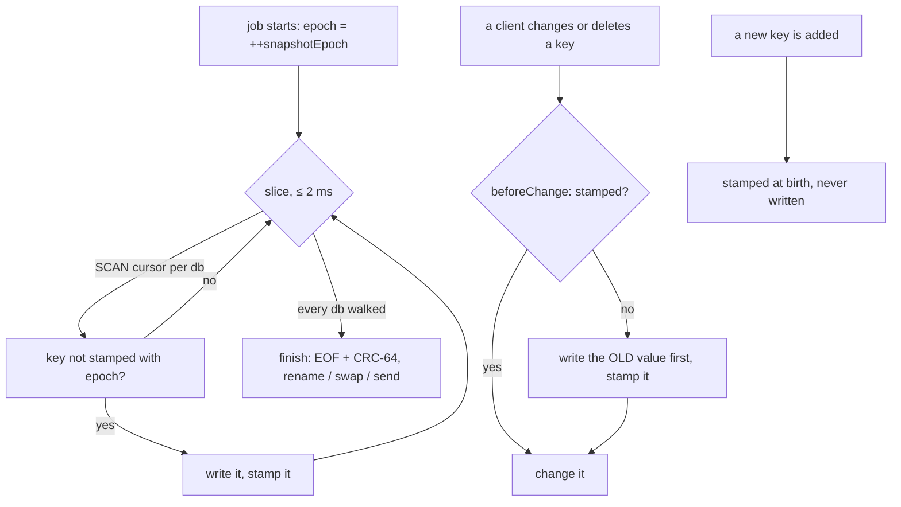

# Architecture

MiniRedis is one Node.js process with one thread running every command (spec rule 1). Everything
global hangs off one `Server` object ([server.ts](../src/server/server.ts)), passed explicitly,
so tests can start several servers in one process. This page has the module map and the three
flows worth drawing: the architecture, the life of one command, and the replication handshake.

## The big picture



The rules the picture encodes:

- **Commands only touch keys through `Db`** (rule 5). That one door is what lets expiry, WATCH,
  memory accounting, the dirty counter and the copy-on-write hook see every change.
- **Every change leaves through `propagate()`** (rule 6), once, in order, already rewritten into
  an exact form (`EXPIRE` → `PEXPIREAT`, `SPOP` → `SREM`). The AOF and the replication stream
  are just two sinks on it.
- **Replies leave only in `beforeSleep`**, after the AOF write (rule 8), with one socket write
  per client per event-loop turn, however many commands it pipelined.
- **Background work comes in slices.** Rehashing, active expiry, eviction and snapshot jobs
  each run against a small time budget, so the loop never stalls (rule 10).

## Module map

| Layer                  | Files                                                                                                                                                                                                                                                                                          | What it owns                                                                                               |
| ---------------------- | ---------------------------------------------------------------------------------------------------------------------------------------------------------------------------------------------------------------------------------------------------------------------------------------------- | ---------------------------------------------------------------------------------------------------------- |
| Entry                  | [index.ts](../src/index.ts), [config.ts](../src/config.ts)                                                                                                                                                                                                                                     | flags and config file, CONFIG GET/SET, signals                                                             |
| Server                 | [server.ts](../src/server/server.ts), [client.ts](../src/server/client.ts), [event-loop.ts](../src/server/event-loop.ts), [cron.ts](../src/server/cron.ts), [propagate.ts](../src/server/propagate.ts), [limits.ts](../src/server/limits.ts), [shutdown.ts](../src/server/shutdown.ts)         | sockets, the read path, beforeSleep, serverCron, propagation, client limits, shutdown                      |
| Protocol (pure)        | [parser.ts](../src/protocol/parser.ts), [encoder.ts](../src/protocol/encoder.ts), [errors.ts](../src/protocol/errors.ts)                                                                                                                                                                       | incremental RESP + inline parsing, RESP2/RESP3 reply builders, Redis's exact error strings                 |
| Commands               | [registry.ts](../src/commands/registry.ts), [dispatch.ts](../src/commands/dispatch.ts), [command.ts](../src/commands/command.ts), one file per group                                                                                                                                           | the command table, the checks in Redis's order, MULTI queueing, stats, handlers                            |
| Data structures (pure) | [dict.ts](../src/datastructures/dict.ts), [skiplist.ts](../src/datastructures/skiplist.ts), [zset.ts](../src/datastructures/zset.ts), [quicklist.ts](../src/datastructures/quicklist.ts)                                                                                                       | hash table with incremental rehash and SCAN cursor, skip list with spans, list as linked chunks            |
| Storage                | [database.ts](../src/storage/database.ts), [redis-object.ts](../src/storage/redis-object.ts), [expiry.ts](../src/storage/expiry.ts), [eviction.ts](../src/storage/eviction.ts), [memory.ts](../src/storage/memory.ts), [watch.ts](../src/storage/watch.ts)                                     | the one door to keys, lazy and active expiry, eviction pool, memory estimates, WATCH                       |
| Persistence            | [aof.ts](../src/persistence/aof.ts), [aof-rewrite.ts](../src/persistence/aof-rewrite.ts), [snapshot-job.ts](../src/persistence/snapshot-job.ts), [snapshot-format.ts](../src/persistence/snapshot-format.ts), [crc64.ts](../src/persistence/crc64.ts), [files.ts](../src/persistence/files.ts) | AOF append and load, rewrite with its buffer, the copy-on-write engine, the binary format, safe file swaps |
| Replication            | [primary.ts](../src/replication/primary.ts), [replica.ts](../src/replication/replica.ts), [backlog.ts](../src/replication/backlog.ts)                                                                                                                                                          | the stream, PSYNC, WAIT; the handshake, applying with exact offsets, promotion; the ring buffer            |
| Pub/sub, blocking      | [hub.ts](../src/pubsub/hub.ts), [waiters.ts](../src/blocking/waiters.ts)                                                                                                                                                                                                                       | channels and patterns; blocked clients per key, timeouts, wake order                                       |
| Observability          | [info.ts](../src/observability/info.ts), [slowlog.ts](../src/observability/slowlog.ts), [monitor.ts](../src/observability/monitor.ts), [metrics-http.ts](../src/observability/metrics-http.ts), [client-info.ts](../src/observability/client-info.ts)                                          | INFO, SLOWLOG, MONITOR, `/metrics`, CLIENT LIST lines                                                      |
| Utilities (pure)       | [numbers.ts](../src/utils/numbers.ts), [glob.ts](../src/utils/glob.ts), [hash.ts](../src/utils/hash.ts), [random.ts](../src/utils/random.ts), [logger.ts](../src/utils/logger.ts)                                                                                                              | strict int64/float rules, Redis globs, MurmurHash3, seedable PRNG, Redis-style log lines                   |

`protocol/`, `datastructures/` and `utils/` import nothing else from `src/`, and `commands/`
never touch a socket or a file (spec 4).

## The life of one command

`SET user:1 alice` from `redis-cli`, arriving in two TCP chunks:



Two details make this fast and correct at once:

- **The parser keeps partial input** as a queue of the socket's own Buffers and resumes where it
  stopped, so half a command and a thousand commands in one packet are the same code path.
- **Nothing is written to a socket during the command.** All replies of the turn are joined and
  sent together, after the AOF bytes reached the OS, which is what makes `kill -9` lose no
  acknowledged write.

## Replication

A replica runs this handshake against its primary, then applies the stream as a privileged
client whose replies are discarded (spec 9.13):

```mermaid
sequenceDiagram
  autonumber
  participant R as Replica
  participant P as Primary
  participant J as Snapshot job (memory sink)

  R->>P: PING
  P-->>R: +PONG
  opt masterauth set
    R->>P: AUTH <masterauth>
    P-->>R: +OK
  end
  R->>P: REPLCONF listening-port <port>
  P-->>R: +OK
  R->>P: REPLCONF capa psync2
  P-->>R: +OK
  R->>P: PSYNC <replid> <offset+1>  (or PSYNC ? -1)
  alt replid matches and the offset is in the backlog
    P-->>R: +CONTINUE <replid>
    P-->>R: the backlog from <offset+1>
  else anything else
    P-->>R: +FULLRESYNC <replid> <masterReplOffset>
    P->>J: start a copy-on-write snapshot
    Note over P,R: new stream bytes are queued for R;<br/>a bare \n every second keeps the link alive
    J-->>P: snapshot bytes
    P-->>R: $<len>\r\n<snapshot>
    P-->>R: the queued stream
    Note over R: check the CRC, load into fresh dbs,<br/>swap them in, offset = <masterReplOffset>
  end
  loop steady state
    P-->>R: each write, once, in order (+ PING every 10 s)
    Note over R: offset += bytes of each applied command
    R->>P: REPLCONF ACK <offset> (every second)
  end
```

What keeps it exact:

- **Offsets count applied bytes, not received ones** ([ADR 0015](adr/0015-replica-offset-counts-applied-bytes.md)).
  A command cut between two TCP chunks isn't counted until it has run, so a reconnect asks for
  exactly the next byte.
- **The backlog is a ring buffer** of the newest `repl-backlog-size` bytes
  ([ADR 0014](adr/0014-replication-backlog.md)). A short disconnect is served from it with
  `+CONTINUE`; a long one falls back to a full sync.
- **Promotion keeps history.** `REPLICAOF NO ONE` moves the old replid to `replid2`, so the
  other replicas can `PSYNC` against the new primary and still get `+CONTINUE`.

## Point-in-time snapshots without `fork()`

Redis forks and lets the OS copy pages on write. Node can't fork, so the engine in
[snapshot-job.ts](../src/persistence/snapshot-job.ts) does the copying in code
([ADR 0010](adr/0010-copy-on-write-snapshots.md)):



SCAN returns every key that existed for the whole walk; the hook caught every other key before
it changed or vanished. So each key is written exactly once, as it was when the job started,
and BGSAVE, AOF rewrite and a replica's full sync all share the same engine with different sinks.
